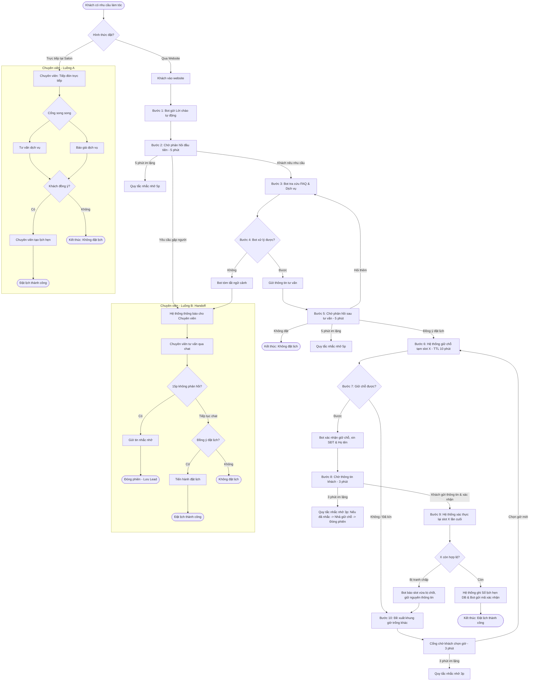
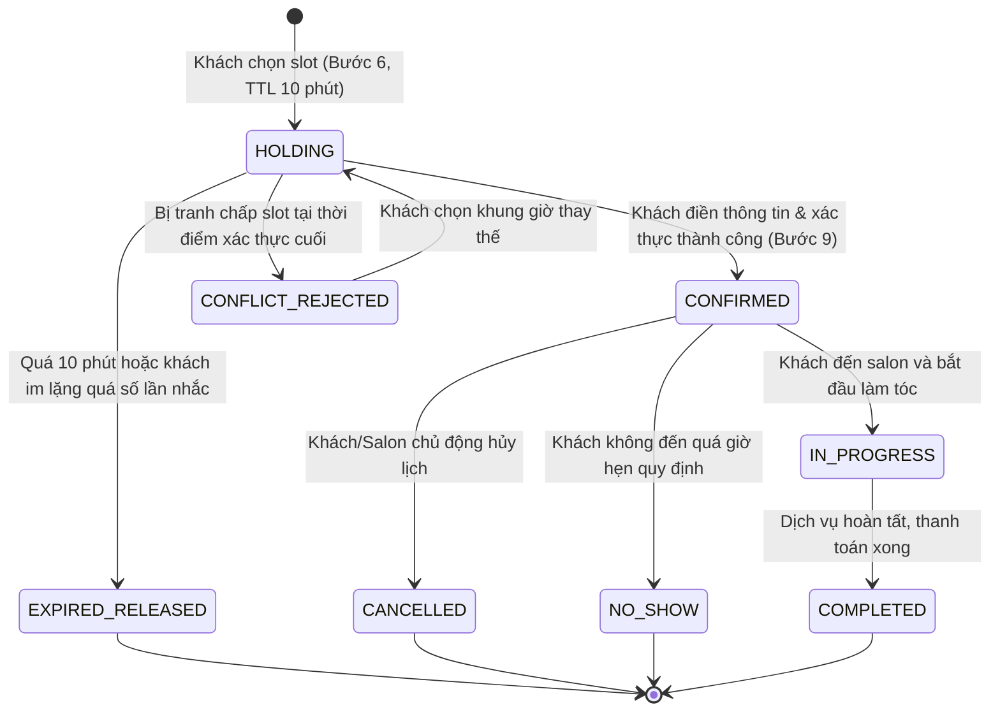

# TÀI LIỆU PHÂN TÍCH NGHIỆP VỤ QUY TRÌNH ĐẶT LỊCH LÀM TÓC (SALON1)

> **Mã tài liệu**: `BA-SALON1-001`  
> **Phiên bản**: `1.0.0`  
> **Ngày lập**: 28/10/2026  
> **Người thực hiện**: Data & Workflow Extraction Specialist  
> **Nguồn dữ liệu**:  
> - File Excel đặc tả quy trình: `docs/quy_trinh_dat_lich_SALON1_1sheet.xlsx`  
> - File JSON chuẩn hóa: `docs/prepared/booking_process.json`  
> - Báo cáo giải pháp bổ trợ: `docs/Chatbot_DatLichToc_Report.xlsx`  

---

## 1. TỔNG QUAN VÀ BỐI CẢNH DỰ ÁN

Hệ thống đặt lịch làm tóc Salon Lumière (SALON1) hướng tới việc tự động hóa tối đa quy trình tư vấn và giữ chỗ cho khách hàng thông qua trợ lý ảo AI (Chatbot NLU tiếng Việt), đồng thời duy trì sự linh hoạt khi kết nối liền mạch với Chuyên viên tư vấn / Lễ tân khi có nhu cầu chuyên sâu hoặc ngoại lệ.

Mô hình nghiệp vụ được tổ chức theo chuẩn BPMN 2.0 bao gồm **2 Pools** chính tương tác với nhau qua các Message Flow:
1. **Pool Khách hàng (Customer)**: Thể hiện hành trình trải nghiệm của khách từ lúc phát sinh nhu cầu đến khi chốt lịch thành công hoặc rời bỏ.
2. **Pool Salon (Nhà cung cấp dịch vụ)**: Gồm **3 Lanes** chuyên biệt:
   - **Lane AI Tư vấn (Chatbot)**: Tự động chào hỏi, giải đáp dịch vụ/FAQ, giữ chỗ tạm, thu thập thông tin và nhắc nhở khi khách im lặng.
   - **Lane Hệ thống đặt lịch (Booking Engine)**: Thực hiện các nghiệp vụ then chốt về dữ liệu: giữ chỗ tạm thời (TTL 10 phút), xác thực tính hợp lệ của slot, ghi lịch chính thức vào CSDL (Sổ lịch hẹn), và tự động nhả slot khi quá hạn.
   - **Lane Chuyên viên tư vấn (Staff / Stylist)**: Xử lý khách đến trực tiếp tại quầy (Luồng A) hoặc nhận chuyển giao (Handoff - Luồng B) từ Chatbot khi gặp trường hợp phức tạp.

---

## 2. GIAI ĐOẠN 2: CHI TIẾT PHÂN TÍCH NGHIỆP VỤ

### 2.1. QUY TRÌNH TỔNG THỂ (OVERALL WORKFLOW)

#### 2.1.1. Các điểm bắt đầu (Start Points)
Hệ thống hỗ trợ 3 điểm kích hoạt quy trình:
1. **Điểm bắt đầu 1 - Đặt qua Website (Chatbot)**: Khách hàng truy cập website salon -> Mở khung chat -> Hệ thống kích hoạt Lane AI Tư vấn gửi "Lời chào tự động".
2. **Điểm bắt đầu 2 - Đặt trực tiếp tại Salon (Luồng A)**: Khách đến trực tiếp salon -> Chuyên viên tư vấn / Lễ tân tiếp đón trực tiếp.
3. **Điểm bắt đầu 3 - Chuyển giao hỗ trợ (Luồng B - Handoff)**: Khách chủ động yêu cầu gặp nhân viên hoặc Chatbot không đủ dữ liệu xử lý -> Hệ thống tóm tắt ngữ cảnh và kích hoạt màn hình Chuyên viên tư vấn.

#### 2.1.2. Trình tự các bước theo BPMN và Luồng tương tác

#### 2.1.3. Bảng phân định Vai trò (RACI Matrix)

| Vai trò | Mô tả nhiệm vụ trong quy trình | Trách nhiệm chính |
| :--- | :--- | :--- |
| **Khách hàng (Customer)** | Khách hàng vãng lai hoặc tài khoản thành viên có nhu cầu làm đẹp. | Cung cấp nhu cầu, chọn khung giờ, điền thông tin liên hệ, xác nhận chốt. |
| **AI Tư vấn (Chatbot)** | Trợ lý thông minh 24/7 trực tiếp giao tiếp văn bản tự nhiên với khách. | Chào hỏi, tra cứu FAQ/Bảng giá, hướng dẫn chọn slot, gửi lời nhắc, chuyển giao nhân viên. |
| **Hệ thống đặt lịch (Booking Engine)** | Backend API và tầng CSDL xử lý giao dịch thời gian thực. | Khóa giữ chỗ tạm (TTL 10m), kiểm tra xung đột slot, commit lịch vào CSDL, nhả slot tự động. |
| **Chuyên viên tư vấn (Consultant/Staff)** | Lễ tân, thợ chính hoặc nhân viên chăm sóc khách hàng. | Tiếp đón trực tiếp tại salon (Luồng A), chat tiếp nhận ca handoff (Luồng B), tạo lịch thủ công. |
| **Thợ làm tóc (Stylist)** | Kỹ thuật viên trực tiếp thực hiện dịch vụ cho khách. | Cung cấp lịch làm việc, nhận phân bổ ca từ lịch hẹn đã chốt. |
| **Quản trị viên (Admin)** | Người quản lý hệ thống salon. | Cấu hình biểu giá, dịch vụ, danh sách stylist, prompt AI, giám sát hội thoại và thống kê. |

#### 2.1.4. Chi tiết Input và Output từng giai đoạn

| Giai đoạn | Dữ liệu Đầu vào (Inputs) | Dữ liệu Đầu ra (Outputs) | Cơ chế chuyển tiếp |
| :--- | :--- | :--- | :--- |
| **Khởi tạo & Lời chào** | Sự kiện truy cập web hoặc mở widget chat. | Lời chào tự động thân thiện kèm gợi ý dịch vụ hot. | Kích hoạt bộ đếm timeout 5 phút đầu tiên. |
| **Tư vấn dịch vụ & Báo giá** | Câu hỏi dạng tự nhiên của khách (tên kiểu tóc, tình trạng tóc, ngân sách). | Dữ liệu từ `Bảng dịch vụ & FAQ`: Tên dịch vụ, thời lượng dự kiến, khoảng giá/giá chính xác. | Nếu AI không giải quyết được -> kích hoạt handoff. |
| **Giữ chỗ tạm thời (Bước 6)** | Khung giờ `X` (ngày, giờ, stylist nếu có), ID phiên chat/khách hàng. | Bản ghi `Temporary Lock` trong bộ nhớ/DB có `TTL = 10 phút`. | Trả kết quả: Thành công -> xin thông tin; Thất bại -> đề xuất slot khác. |
| **Thu thập thông tin (Bước 8)** | Họ và tên, Số điện thoại (bắt buộc), ghi chú bổ sung. | Dữ liệu khách hàng đã chuẩn hóa, sẵn sàng commit. | Kiểm tra tính hợp lệ của SĐT (10 số). |
| **Xác thực & Chốt lịch (Bước 9)** | Mã giữ chỗ tạm, thông tin slot `X`, thông tin khách hàng. | - Bản ghi lịch hẹn chính thức trong `Sổ lịch hẹn` (DB) - Mã đặt lịch (Booking Code) - Tin nhắn xác nhận gửi khách. | Giao dịch nguyên tử (Atomic Transaction) chống xung đột. |
| **Chuyển giao Chuyên viên (Luồng B)** | Lịch sử đoạn chat, lý do chuyển giao, thông tin khách đã biết. | Thẻ tóm tắt ngữ cảnh (Context Summary) gửi tới màn hình quản trị của nhân viên. | Đổi trạng thái hội thoại từ `BOT` sang `STAFF`. |

#### 2.1.5. Vòng đời Trạng thái Lịch hẹn (Appointment State Machine)

- **`HOLDING` (Giữ chỗ tạm)**: Trạng thái lock mềm, có hạn sử dụng 10 phút (`expires_at = now() + 10m`). Slot này tạm thời bị ẩn khỏi danh sách trống của khách khác.
- **`CONFIRMED` (Đã xác nhận)**: Lịch hẹn chính thức, có mã booking (ví dụ: `BK-20261028-001`), ghi nhận trong CSDL.
- **`CANCELLED` (Đã hủy)**: Hủy bỏ trước giờ hẹn theo yêu cầu.
- **`COMPLETED` (Hoàn thành)**: Dịch vụ đã hoàn tất.
- **`NO_SHOW` (Khách vắng mặt)**: Khách không đến đúng hẹn và không thông báo trước.

#### 2.1.6. Điểm kết thúc quy trình (Final Outcomes)
Quy trình luôn kết thúc tại một trong **4 kết quả chuẩn hóa**:
1. **Đặt lịch thành công (`BOOKING_SUCCESS`)**: Tạo được lịch hẹn chính thức trong CSDL (qua Bot hoặc Chuyên viên).
2. **Không đặt lịch (`NOT_BOOKED`)**: Khách chủ động từ chối hoặc không có nhu cầu tiếp tục.
3. **Phiên đóng - Lưu lead (`SESSION_CLOSED_LEAD_SAVED`)**: Khách ngưng phản hồi sau khi đã gửi tin nhắc nhở. Toàn bộ thông tin hội thoại, nhu cầu và SĐT (nếu có) được lưu vào danh sách Khách hàng tiềm năng để Lễ tân chăm sóc lại.
4. **Chuyển cho nhân viên (`HANDED_OFF_TO_STAFF`)**: Phiên bot kết thúc ở phía tự động, chuyển quyền điều khiển sang nhân viên thật.

---

### 2.2. HỆ THỐNG QUY TẮC NGHIỆP VỤ (BUSINESS RULES)

#### 2.2.1. Quy tắc Giữ chỗ tạm và Thời hạn khóa (Temporary Hold & TTL)
- **Quy tắc 1 (Two-Phase Booking)**: Tuyệt đối không cho phép tạo lịch chính thức ngay khi khách vừa phát biểu giờ muốn làm. Bắt buộc phải qua 2 giai đoạn:
  1. *Giai đoạn 1 (Phase 1)*: Khóa mềm slot `X` trong 10 phút.
  2. *Giai đoạn 2 (Phase 2)*: Khách điền thông tin liên hệ -> Xác thực lại slot lần 2 -> Commit ghi lịch.
- **Quy tắc 2 (TTL 10 phút)**: Thời gian giữ chỗ tạm tối đa là **10 phút**. Nếu sau 10 phút giao dịch không hoàn tất, cơ chế khóa tự động vô hiệu hóa và nhả slot về trạng thái tự do.

#### 2.2.2. Quy tắc Xử lý Trùng lịch & Xung đột đồng thời (Concurrency & Double-Booking)
- **Quy tắc 3 (Phát hiện xung đột đa tầng)**:
  - Kiểm tra lần 1: Tại Bước 6 trước khi lock slot.
  - Kiểm tra lần 2: Tại Bước 9 trước khi commit vào CSDL.
- **Quy tắc 4 (Bảo toàn dữ liệu khi bị tranh chấp - Data Preservation)**:
  - Nếu tại Bước 9, slot `X` đã bị khách khác hoặc nhân viên tại quầy chốt trước: Chatbot **KHÔNG** bắt khách nhập lại thông tin cá nhân.
  - Hệ thống phải giữ nguyên Họ tên, SĐT, danh sách dịch vụ đã chọn, và chuyển thẳng sang Bước 10 để đề xuất 2-3 khung giờ trống gần nhất để khách chọn lại bằng 1 chạm.

#### 2.2.3. Quy tắc Khung giờ làm việc & Đề xuất Slot
- **Quy tắc 5 (Khung giờ hoạt động)**:
  - Giờ mở cửa salon: 08:30 - 20:30 hàng ngày.
  - Khung giờ đặt lịch phải cách giờ đóng cửa ít nhất bằng thời lượng tối thiểu của dịch vụ ngắn nhất (khoảng 30 phút).
- **Quy tắc 6 (Thời lượng dịch vụ - Service Duration)**:
  - Khi khách chọn combo (ví dụ: Cắt + Uốn + Nhuộm), thời lượng tổng phải là tổng thời gian các dịch vụ (ví dụ: 30p + 90p + 60p = 180 phút). Hệ thống phải kiểm tra xem stylist/salon có liên tục đủ 180 phút trống hay không.

#### 2.2.4. Quy tắc Thông tin bắt buộc (Mandatory Fields)
- Để tạo lịch thành công, hệ thống bắt buộc phải thu thập đủ:
  1. **Họ và tên khách hàng**: Chuỗi ký tự từ 2 - 50 ký tự.
  2. **Số điện thoại**: Định dạng hợp lệ tại Việt Nam (10 chữ số, bắt đầu bằng `03`, `05`, `07`, `08`, `09`).
  3. **Dịch vụ lựa chọn**: Ít nhất 1 mã dịch vụ hợp lệ từ danh mục.
  4. **Thời gian hẹn**: Ngày (YYYY-MM-DD) và Giờ bắt đầu (HH:mm).
  5. *(Không bắt buộc)*: Stylist yêu cầu, ghi chú độ dài tóc hoặc tiền sử dị ứng hóa chất.

#### 2.2.5. Quy tắc Nhắc nhở và Quản lý Hết hạn chờ (Timeout & Reminder Rules)
Bảng quy định thời gian chờ và hành động nhắc nhở chuẩn hóa từ tài liệu:

| Điểm chờ trong luồng | Vị trí luồng | Thời gian chờ tối đa | Hành động khi hết giờ (Chưa nhắc) | Hành động khi hết giờ (Đã nhắc rồi) |
| :--- | :---: | :---: | :--- | :--- |
| **Chờ phản hồi đầu tiên** | Bước 2 | **5 phút** | Bot gửi 01 tin nhắc lịch sự hỏi khách có cần hỗ trợ gì không. | Đóng phiên -> Lưu lead. |
| **Chờ phản hồi sau tư vấn** | Bước 5 | **5 phút** | Bot gửi 01 tin nhắc hỏi khách có muốn chốt khung giờ nào không. | Đóng phiên -> Lưu lead. |
| **Chờ thông tin khách (Đang giữ chỗ)** | Bước 8 | **3 phút** | Bot thông báo: *"Dạ em đang giữ chỗ khung giờ X cho mình, anh/chị gửi giúp em SĐT để hoàn tất nhé ạ!"* | **Hệ thống thực hiện NHẢ GIỮ CHỖ slot X**, sau đó Đóng phiên -> Lưu lead. |
| **Chờ khách chọn lại giờ** | Bước 10 | **3 phút** | Bot gửi tin nhắc gợi ý khách chọn nhanh 1 trong các khung giờ đề xuất. | Đóng phiên -> Lưu lead. |
| **Chuyên viên tư vấn qua chat** | Luồng B | **15 phút** | Chuyên viên gửi tin nhắn nhắc nhở. | Đóng phiên -> Lưu lead. |

- **Nguyên tắc "Đã nhắc nhở 1 lần"**: Chỉ nhắc tối đa **01 lần** cho mỗi điểm chờ. Nếu sau lần nhắc mà khách tiếp tục im lặng đến hết thời gian quy định, phiên tự động kết thúc để giải phóng tài nguyên.

#### 2.2.6. Quy tắc Phân quyền Người dùng (RBAC)
- **Nhóm 1 - Khách hàng (Guest / Customer)**:
  - Khách vãng lai: Chat với AI, xem thông tin dịch vụ/FAQ, đặt lịch (cung cấp SĐT).
  - Khách đã đăng nhập: Tự động điền SĐT/Tên, xem lịch sử đặt hẹn của chính mình.
- **Nhóm 2 - Chuyên viên tư vấn / Lễ tân (Staff / Receptionist)**:
  - Tiếp nhận danh sách hội thoại chuyển giao (Handoff inbox).
  - Nhắn tin trực tiếp với khách (Live Chat).
  - Tạo lịch hẹn thủ công tại quầy (Luồng A) hoặc qua chat (Luồng B).
  - Chuyển trả phiên cho Bot nếu khách yêu cầu.
- **Nhóm 3 - Quản trị viên (Admin)**:
  - Cấu hình Prompt, FAQ, biểu giá dịch vụ, danh sách stylist.
  - Xem toàn bộ báo cáo phân tích, log hội thoại, tỉ lệ chốt lịch thành công / thất bại.

---

### 2.3. BẢNG PHÂN LOẠI YÊU CẦU & ĐÁNH GIÁ CHUYÊN SÂU

Để phục vụ tốt nhất cho Giai đoạn 3 (Gap Analysis & Cập nhật Code), các yêu cầu được bóc tách thành 4 nhóm cụ thể:

#### 2.3.1. Nhóm Yêu cầu Rõ ràng (Explicit Requirements - Trực tiếp từ tài liệu)
1. **Kiến trúc 2 Pool & 3 Lane**: Phân định rõ ranh giới trách nhiệm giữa Khách hàng, Chatbot, Hệ thống backend và Chuyên viên.
2. **Cơ chế Giữ chỗ tạm với TTL 10 phút**: Slot phải được giữ trong 10 phút trước khi chốt chính thức.
3. **Cơ chế Xác thực 2 bước (Two-phase validation)**: Kiểm tra slot lúc bắt đầu giữ chỗ (Bước 6) và kiểm tra lại lần cuối trước khi commit (Bước 9).
4. **Bảo lưu thông tin khi trùng slot**: Nếu slot bị chốt bởi người khác ở Bước 9, giữ nguyên thông tin cá nhân của khách và chuyển sang Bước 10.
5. **Cấu hình thời gian chờ chính xác**: 5 phút cho Bước 2 & 5; 3 phút cho Bước 8 & 10; 15 phút cho Luồng B Chuyên viên.
6. **Nhả giữ chỗ bắt buộc tại Bước 8**: Nếu khách im lặng sau khi đã nhắc ở Bước 8, phải giải phóng slot giữ chỗ trước khi đóng phiên.
7. **4 Trạng thái kết thúc chuẩn hóa**: Thành công, Không đặt, Đóng phiên lưu lead, Chuyển nhân viên.
8. **Chuyên viên luồng A chạy song song**: Vừa tư vấn dịch vụ vừa báo giá cùng lúc trước khi chốt.

#### 2.3.2. Nhóm Yêu cầu Suy ra (Inferred Requirements - Kỹ thuật cần có để chạy trơn tru)
1. **Quản lý Hạn giữ chỗ bằng Background Worker / TTL**:
   - Cần trường `holding_token`, `hold_expires_at` và `status = 'HOLDING'` trong CSDL (hoặc Redis/Memory store).
   - Cần một tác vụ ngầm (cron job hoặc setTimeout) quét các bản ghi `HOLDING` quá hạn để tự động chuyển về trạng thái giải phóng (`RELEASED`).
2. **Máy trạng thái Hội thoại (Conversation State Machine)**:
   - Cần lưu trường `state` trong bảng `conversations`: `GREETING`, `CONSULTING`, `WAITING_SLOT_SELECTION`, `HOLDING_SLOT`, `WAITING_CUSTOMER_INFO`, `HANDOFF_STAFF`, `CLOSED`.
   - Cần lưu cờ `reminder_sent: boolean` và `last_interaction_at: timestamp` để bộ đếm timeout biết đã gửi nhắc nhở hay chưa.
3. **Cơ chế Realtime & Handoff Notification**:
   - Khi bot chuyển sang Chuyên viên (Luồng B), hệ thống phải phát sự kiện Socket.IO (`conversation:handoff`) đến phòng chat của nhân viên kèm bản tóm tắt tóm lược nhu cầu.
4. **Lưu trữ Lead (Khách hàng tiềm năng)**:
   - Khi phiên đóng do khách im lặng (`SESSION_CLOSED_LEAD_SAVED`), hệ thống cần đánh dấu bản ghi conversation với `is_lead = true` và lưu các thực thể (dịch vụ khách quan tâm, SĐT nếu đã có) để phục vụ chiến dịch Re-marketing / Telesale.
5. **Bảo đảm tính toàn vẹn dữ liệu (Atomic Database Lock)**:
   - Tại Bước 9, việc ghi lịch hẹn vào CSDL phải chạy trong giao dịch an toàn (Database Transaction hoặc mutex lock) để ngăn tuyệt đối 2 yêu cầu đồng thời cùng commit 1 slot.

#### 2.3.3. Nhóm Điểm chưa rõ (Ambiguities & Cần lưu ý)
1. **Xác thực danh tính Khách vãng lai**: Tài liệu quy định xin Tên + SĐT, nhưng chưa nêu rõ có cần gửi mã xác thực SMS OTP không, hay chỉ cần regex kiểm tra định dạng SĐT là cho phép chốt lịch.
2. **Chính sách Đặt cọc (Deposit)**: Các dịch vụ kỹ thuật hóa chất có giá trị cao (như uốn/nhuộm 1-2 triệu đồng) có yêu cầu thanh toán cọc trước một phần để chống "bùng lịch" (No-show) hay không?
3. **Cơ chế chọn Stylist**: Khách có quyền chỉ định thợ làm tóc cụ thể trong phiên chat không, hay hệ thống mặc định xếp thợ theo ca trực trống ngẫu nhiên?
4. **Xử lý yêu cầu Ngoài giờ làm việc (Off-hours)**: Khi khách nhắn tin lúc nửa đêm (23:00 - 06:00), bot trả lời thế nào? Nếu khách yêu cầu gặp nhân viên lúc này thì hiển thị thông báo gì (ví dụ: hẹn liên hệ lại vào 8h30 sáng hôm sau)?
5. **Đổi / Hủy lịch sau khi đã đặt**: Khách hàng có thể tự hủy hoặc đổi lịch thông qua Chatbot bằng cách nhập mã lịch hẹn không, hay bắt buộc phải gọi điện / gặp Chuyên viên?

#### 2.3.4. Đề xuất Cải tiến (Actionable Recommendations)
1. **Thiết kế Nút bấm tương tác nhanh (Quick Reply Chips)**:
   - Trên giao diện Chatbot, thay vì bắt khách gõ chữ cho các bước chọn giờ (Bước 6, Bước 10), hiển thị trực tiếp các nút chọn slot: `[ Hôm nay 14:00 ]`, `[ Hôm nay 16:30 ]`, `[ Ngày mai 09:00 ]` để tăng tốc độ chốt lịch gấp 3 lần và tránh lỗi gõ sai định dạng ngày giờ.
2. **Tự động gửi Xác nhận đa kênh (SMS / Zalo ZNS)**:
   - Ngay sau khi Bước 9 thành công, bên cạnh tin nhắn trong khung chat, gửi 1 tin nhắn SMS/Zalo ZNS chứa mã booking, địa chỉ salon trên Google Maps và lưu ý trước khi làm tóc.
3. **Bộ đếm thời gian thực (Countdown Timer Widget) khi Giữ chỗ**:
   - Khi ở Bước 8 (đang giữ chỗ tạm), hiển thị đồng hồ đếm ngược 10 phút trên thanh tiêu đề chat widget: *"Khung giờ của bạn đang được giữ trong 09:59"*. Điều này tạo hiệu ứng khan hiếm (scarcity) thúc đẩy khách điền SĐT nhanh chóng.
4. **Cơ chế Tự động Nhắc lịch trước 2 tiếng (Appointment Reminder)**:
   - Trước giờ hẹn 2 tiếng, tự động gửi tin nhắn hỏi khách có đến đúng hẹn hay cần hỗ trợ dời lịch, giúp giảm thiểu tối đa tỷ lệ No-show cho Salon.

---

## 3. TỔNG KẾT BÀN GIAO CHO GIAI ĐOẠN 3

Toàn bộ quy trình nghiệp vụ đã được:
- ✅ **Trích xuất & kiểm chứng 100%** từ file nguồn `quy_trinh_dat_lich_SALON1_1sheet.xlsx`.
- ✅ **Chuẩn hóa ra JSON** tại `docs/prepared/booking_process.json` phục vụ việc nạp tự động vào code / AI tools.
- ✅ **Phân tích toàn diện** trong tài liệu này với đầy đủ sơ đồ luồng, bảng RACI, danh mục quy tắc, máy trạng thái, và phân loại yêu cầu.

Dữ liệu và tài liệu đã sẵn sàng để nhóm tiến hành **Giai đoạn 3: Gap Analysis & Triển khai Cập nhật Mã nguồn (Source Code Implementation)**.
